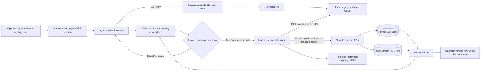
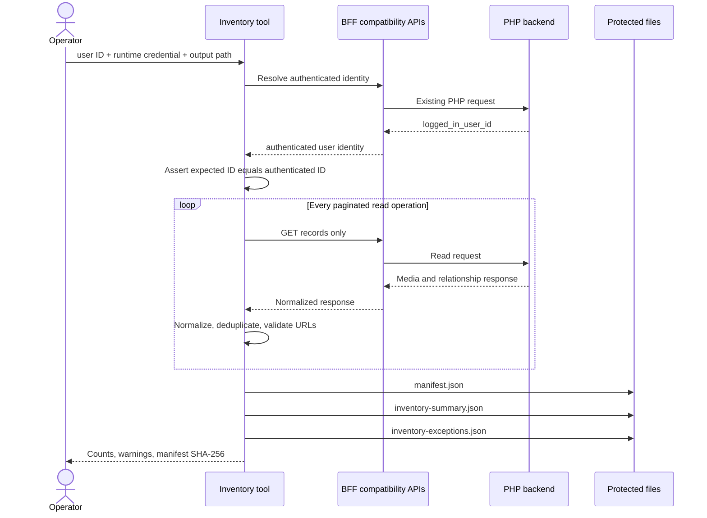
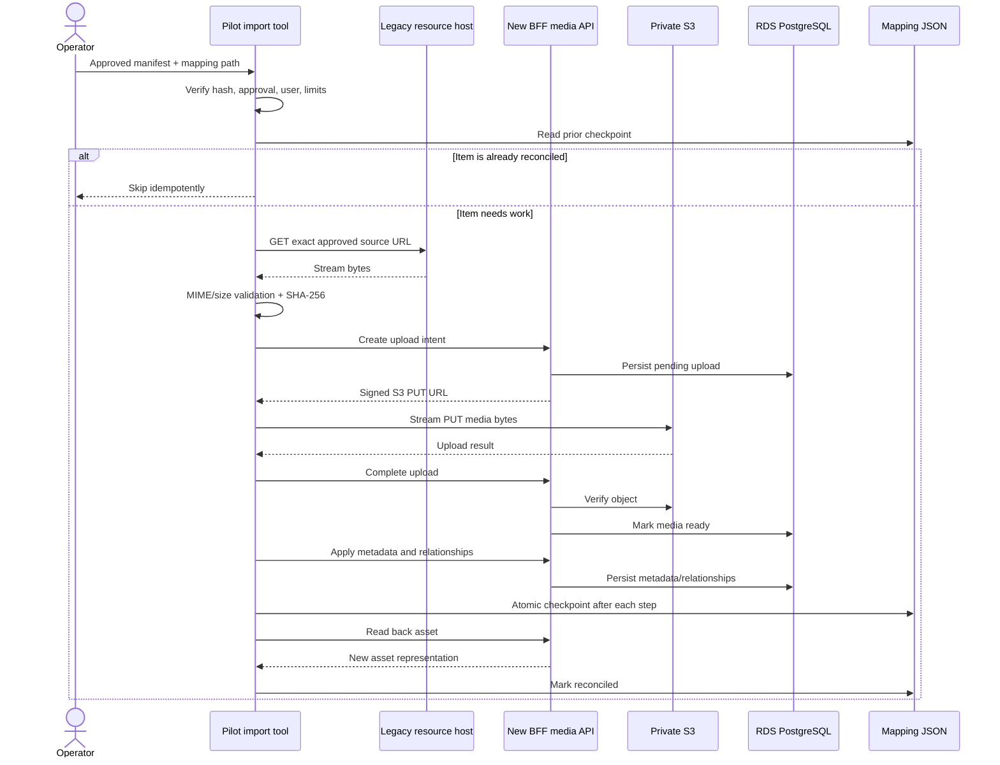
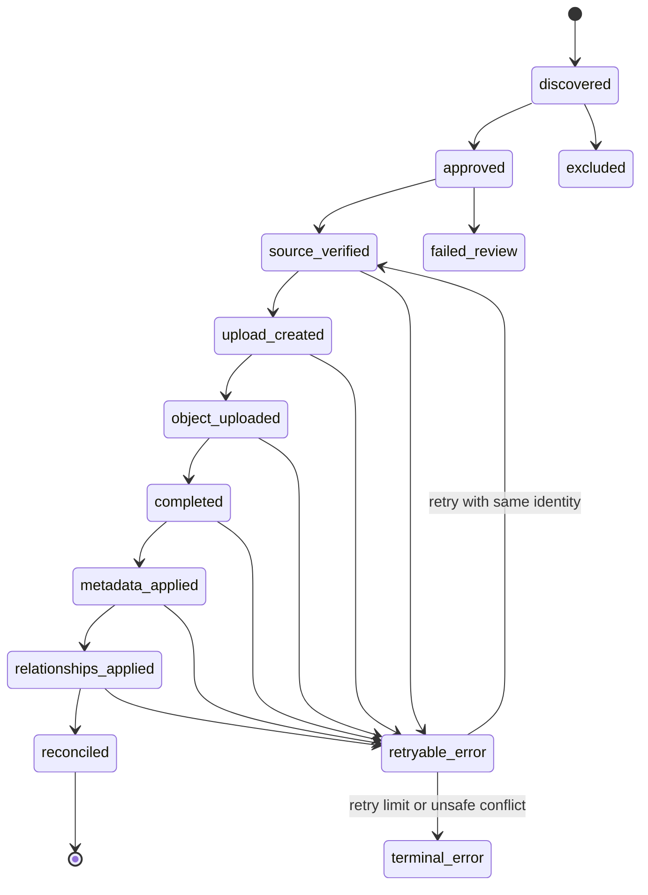

# Legacy media inventory and pilot import guide

## 1. Purpose

This guide defines a safe, restartable way to discover and migrate media for **one explicitly selected existing user** without requiring a PHP-team code change or direct access to the legacy database.

The pilot uses two non-production tools:

1. `legacy-media-inventory` reads the legacy-facing APIs and creates an auditable manifest. It does not download media.
2. `legacy-media-pilot-import` consumes an approved manifest, copies only those approved files into the new private S3 bucket, creates records through the new BFF media APIs, restores known relationships, and produces reconciliation results.

The legacy system remains the source of truth during the pilot. Nothing is moved or deleted from it.

## 2. Scope and constraints

### In scope

- One authenticated user per run.
- Media visible to that user through existing read APIs.
- Photos, videos, and audio.
- Available metadata such as captions, descriptions, dates, location, and transcript text.
- Relationships exposed by APIs, including stories/timeline, contacts, contributions, profile media, advice, reflections, moments, and shares.
- Copying approved media to private S3 storage and creating new RDS records through BFF APIs.
- Repeatable execution, idempotency, error reporting, and before/after reconciliation.

### Out of scope for the pilot

- Crawling the public `/resources/` directory to infer ownership.
- Reading or writing the PHP database directly.
- Writing to the PHP application or legacy filesystem.
- Migrating every user.
- Deleting or replacing legacy media.
- Switching production traffic to the new gallery.
- Reconstructing records not exposed by any read API, such as orphan database rows or hidden historical states.

## 3. Safety rules

These rules are non-negotiable:

- The operator must provide both the authenticated session and the expected legacy user ID. The tool stops if the identity does not match.
- Inventory uses `GET` requests only. Any redirect to an unapproved host or any attempted mutation is rejected.
- Import fetches only an exact URL already recorded in the approved manifest. It never enumerates or recursively walks `/resources/`.
- Source URLs must be HTTPS and match an allowlist such as `legacy.example.invalid`.
- Tokens, cookies, presigned S3 URLs, and private media bytes must never appear in Git, manifests, logs, or reports.
- Manifest and mapping files live in a protected directory outside all repositories and should be mode `0600`.
- The importer copies bytes; it never moves or deletes the legacy object.
- Each item is checkpointed after every durable step, allowing a stopped run to restart safely.
- Production bulk migration must not use the pilot JSON mapping format. It must use an RDS mapping table and a controlled worker process.

The observed Apache directory listing at `https://legacy.example.invalid/resources/` exposes storage structure. That is a security issue the PHP operations team should address separately by disabling directory indexing. This migration design does not depend on that listing.

## 4. End-to-end architecture



### Trust boundaries

| Boundary | Allowed | Forbidden |
|---|---|---|
| Tool to legacy APIs | Authenticated reads for the selected user | Mutation, broad enumeration, another user's records |
| Tool to legacy media host | GET an exact manifest URL | Directory crawling or guessing paths |
| Tool to new BFF | New media API writes for the selected user | Direct RDS or S3 record fabrication |
| BFF to S3 | Time-limited signed upload/download operations | Public bucket access |
| Local operator storage | Protected manifests, mapping, redacted reports | Tokens, cookies, media blobs, presigned URLs in Git |

## 5. Tool 1: `legacy-media-inventory`

### Goal

Create a stable description of everything that can be safely attributed to the selected user before copying a single byte.

### Inputs

| Input | Required | Notes |
|---|---:|---|
| Legacy/BFF base URL | Yes | Use the environment's approved API endpoint. |
| Authentication source | Yes | Session cookie or token loaded at runtime; never written to output. |
| Expected legacy user ID | Yes | Must equal the authenticated identity returned by the API/session context. |
| Output directory | Yes | Absolute path outside Git with restrictive permissions. |
| Host allowlist | Yes | For example, API host plus `legacy.example.invalid`. |
| Maximum pages/items | Yes | A safety bound that prevents accidental unbounded collection. |

### Read sources

Start with compatibility API operations already available through the BFF:

- `GET /api/v1/media-assets/groups`
- `GET /api/v1/media-assets?datePeriod=...`
- `GET /api/v1/media-assets/:id`
- `GET /api/v1/media-assets/:id/content`
- `GET /api/v1/media-assets/deletion-impact?ids=...`
- `GET /api/v1/media-assets/organized-groups`
- `GET /api/v1/media-shares/inbox`
- `GET /api/v1/media-shares/outbox`

The inventory must also inspect the authenticated read operations used by profile photo, contacts, stories/timeline, advice, reflections, moments, and contributions. Those results should add relationships to an existing asset entry instead of creating duplicate asset records.

### Inventory flow



### Normalization rules

For each legacy asset, record:

- Stable source identity: source system, source table/module, and legacy record ID.
- Selected user ID and how ownership was established.
- Media type, original filename, reported MIME type, and reported byte size when present.
- Exact source URL used for a later copy. Strip cookies, tokens, signatures, and transient query strings when a stable path can be retained safely.
- Caption, description, taken date, created date, location, and transcript when returned.
- All discovered relationships and the endpoint/evidence that produced each relationship.
- Missing or conflicting fields as explicit warnings rather than invented values.

Deduplicate by stable legacy identity first. If the API emits the same file under different modules, merge relationships. URL equality alone is not a safe identity because URLs may change or be signed.

### Manifest shape

Illustrative schema:

```json
{
  "schemaVersion": 1,
  "sourceSystem": "ysl-legacy-php",
  "legacyUserId": "2123",
  "generatedAt": "2026-10-04T08:00:00Z",
  "inventoryToolVersion": "0.1.0",
  "assets": [
    {
      "source": {
        "table": "photo_gallery",
        "recordId": "88421",
        "ownershipEvidence": "GET /api/v1/media-assets/88421"
      },
      "media": {
        "type": "image",
        "filename": "family-photo.jpg",
        "mimeType": "image/jpeg",
        "byteSize": 1842201,
        "sourceUrl": "https://legacy.example.invalid/resources/photo_gallery/..."
      },
      "metadata": {
        "caption": "Family day",
        "description": null,
        "takenAt": "2022-08-14T00:00:00Z",
        "location": null,
        "transcript": null
      },
      "relationships": [
        {
          "kind": "story",
          "legacyTargetId": "991",
          "evidence": "asset detail response"
        }
      ],
      "warnings": []
    }
  ]
}
```

The final manifest should be canonicalized and hashed with SHA-256. Approval applies to that exact hash. Editing the file invalidates approval.

### Outputs

| File | Purpose |
|---|---|
| `manifest.json` | Complete normalized migration input. |
| `manifest.sha256` | Hash that binds approval to exact content. |
| `inventory-summary.json` | Counts by media type, module, relationship, and missing-field category. |
| `inventory-exceptions.json` | Items that cannot be safely imported without review. |
| `inventory-report.md` | Redacted human-readable review report; no credentials or signed URLs. |

### Required validations

- Authenticated user ID equals the requested user ID.
- All source URLs use HTTPS and allowed hosts/paths.
- Every asset has a stable legacy identity.
- Pagination completes without repeating cursors/pages.
- Conflicting ownership evidence is a hard failure.
- Missing URL, unsupported media type, unknown relationship kind, and missing target ID become exceptions.
- Counts from overlapping endpoints are deduplicated and discrepancies are reported.
- Response bodies are not blindly copied into logs because they may contain private data.

### Inventory success criteria

Inventory is complete only when:

- All configured read endpoints completed.
- No hard ownership or host validation failed.
- Summary totals equal manifest totals plus explicitly excluded exceptions.
- The operator reviews representative assets and relationships.
- The exact manifest hash is approved for import.

## 6. Human approval gate

The importer must refuse an unapproved or modified manifest. Review at least:

- Total media count and count by image/video/audio.
- Count and total reported bytes by legacy folder/module.
- Relationship counts for story, timeline, contact, contribution, profile, advice, reflection, moment, and share.
- Duplicate identities and conflicting metadata.
- Missing URLs, filenames, MIME types, dates, target IDs, and ownership evidence.
- A small visual sample compared with the legacy UI.
- The selected user ID and manifest SHA-256.

Record approval separately, for example in `approval.json`, with manifest hash, user ID, approver, date, and scope. Do not edit the approved manifest.

## 7. Tool 2: `legacy-media-pilot-import`

### Goal

Copy only approved media for the selected user into the new media solution, using public BFF contracts rather than direct S3 or RDS writes.

### Inputs

- Approved `manifest.json`, matching `manifest.sha256`, and approval record.
- Protected mapping JSON path.
- Runtime BFF credential for the same selected user.
- New BFF base URL.
- Concurrency, maximum file size, total-byte budget, retry limit, and request timeouts.
- `--dry-run` by default; an explicit execution flag is required to write.

### Per-asset algorithm

1. Recompute the manifest hash and verify approval.
2. Resolve the authenticated user and compare it with `legacyUserId`.
3. Look up the stable legacy identity in the mapping file.
4. If already reconciled, skip it. If partially complete, resume from the last durable state.
5. Validate the exact source URL against the allowlist.
6. Stream the legacy response; do not load the whole object into memory.
7. Verify HTTP status, byte limit, detected MIME type, and optional reported size. Calculate SHA-256 during the stream.
8. Call the new BFF upload-create endpoint, for example `POST /api/v1/media-library/uploads`.
9. Upload to the returned short-lived signed S3 URL.
10. Call the upload completion endpoint so the BFF verifies and persists the asset.
11. Apply caption, description, dates, location, and other supported metadata through new media APIs.
12. Create each supported relationship through BFF APIs.
13. Persist the mapping after every durable step using an atomic file replacement.
14. Read the new asset back, compare it with the manifest, and mark it reconciled.

If the current API contract names differ, the implementation should adapt to the actual endpoints while preserving this order and the rule that only the BFF owns database mutations.

### Import sequence



### Restartable state machine



States must be monotonic. A retry may resume or revalidate a state, but it must not silently erase a completed mapping.

## 8. Pilot mapping JSON

For a one-user pilot, use a protected JSON file outside Git. It is operational state, not a report.

```json
{
  "schemaVersion": 1,
  "sourceSystem": "ysl-legacy-php",
  "legacyUserId": "2123",
  "manifestSha256": "<approved-sha256>",
  "createdAt": "2026-10-04T09:00:00Z",
  "updatedAt": "2026-10-04T09:12:00Z",
  "items": {
    "photo_gallery:88421": {
      "legacy": {
        "table": "photo_gallery",
        "recordId": "88421",
        "sourceUrlHash": "<sha256-of-redacted-stable-url>"
      },
      "sourceSha256": "<media-content-sha256>",
      "newMediaId": "0b1f5dc1-5caa-4bf3-85c5-7405c2e5ae39",
      "state": "reconciled",
      "completedRelationships": ["story:991"],
      "attempts": 1,
      "lastError": null,
      "updatedAt": "2026-10-04T09:12:00Z"
    }
  }
}
```

Implementation requirements:

- Key by stable source identity: `source_table:legacy_record_id`.
- Never key solely by filename or URL.
- Write to a sibling temporary file, `fsync`, then atomically rename.
- Keep a backup of the previous valid mapping version.
- Do not store access tokens, cookies, signed URLs, or response headers.
- Store the content checksum after a successful legacy download.
- Treat a changed source checksum on retry as a conflict requiring review.
- Protect the directory and file (`0700` directory, `0600` files).

Suggested local layout, outside repositories:

```text
<protected-root>/legacy-media-pilot/user-2123/
├── manifest.json
├── manifest.sha256
├── approval.json
├── inventory-summary.json
├── inventory-exceptions.json
├── mapping.json
├── reconciliation.json
└── logs/
```

Logs must be structured and redacted. Media content should be streamed rather than persisted locally. If a temporary file is unavoidable for a client library, use a restricted temporary directory, remove it immediately after the item, and never include it in backups.

## 9. Production mapping table in RDS

Before migrating multiple users, replace the JSON mapping with a proper table owned by the new media service.

Proposed logical schema:

```sql
CREATE TABLE legacy_media_mappings (
  id uuid PRIMARY KEY,
  source_system text NOT NULL,
  source_table text NOT NULL,
  legacy_record_id text NOT NULL,
  legacy_user_id text NOT NULL,
  media_asset_id uuid NULL,
  manifest_sha256 text NOT NULL,
  source_url_hash text NULL,
  source_content_sha256 text NULL,
  migration_state text NOT NULL,
  completed_relationships jsonb NOT NULL DEFAULT '[]'::jsonb,
  attempt_count integer NOT NULL DEFAULT 0,
  last_error_code text NULL,
  last_error_detail_redacted text NULL,
  first_seen_at timestamptz NOT NULL,
  last_attempted_at timestamptz NULL,
  reconciled_at timestamptz NULL,
  created_at timestamptz NOT NULL,
  updated_at timestamptz NOT NULL,
  UNIQUE (source_system, source_table, legacy_record_id)
);
```

Recommended constraints and indexes:

- Foreign key from `media_asset_id` to `media_library_assets` after the new asset exists.
- Index on `(legacy_user_id, migration_state)` for worker scheduling and user reconciliation.
- Index on `media_asset_id` for reverse lookup.
- Enumerated or checked migration states.
- Row access limited to the migration service role; not exposed to browsers.
- Error detail must be redacted and size bounded.

The mapping table is an idempotency and audit structure. It is not the canonical media record; the existing media-library tables remain canonical for migrated assets.

## 10. Relationship mapping

The legacy `photo_gallery_usage` data and normalized API responses indicate at least `story`, `contact`, and `contribution` usage. Other features may expose media through their own reads. The inventory should normalize them into explicit relationship records.

| Legacy context | New relationship target | Important rule |
|---|---|---|
| Photo gallery item | Library asset owned by user | One asset even when used in multiple places. |
| Story/timeline media | `story:<legacy-or-mapped-id>` | Do not create a relationship until the target identity is known. |
| Contact photo | `contact:<legacy-contact-id>` | Ownership remains the logged-in user's media; contact is the subject/target. |
| Contribution/comment attachment | `contribution:<legacy-id>` | Preserve contributor and story target when exposed. |
| Profile photo | `profile-avatar:<legacy-user-id>` | Mark active avatar separately from historical profile media. |
| Advice media | `advice:<legacy-id>` | Preserve section/order when available. |
| Reflection media | `reflection:<legacy-id>` | Preserve section/order when available. |
| Moment media | `moment:<legacy-id>` | Preserve section/order when available. |
| Share | `share:<legacy-share-id>` | Migrate only when recipient identity and authorization state are exposed safely. |

Relationships with unknown target IDs go to exceptions; the importer must not invent targets. If the associated domain has not yet moved to the new BFF, store a namespaced legacy target reference so it can be resolved later without rewriting the asset.

## 11. Transcript limitation

The legacy APIs may expose transcript text for audio/video. The current new media asset model does not yet provide a durable transcript field/table for the migration.

For the pilot:

- Capture legacy transcript text in the protected manifest.
- Mark it as `pending_target_support` during reconciliation.
- Do not drop, regenerate, or send it to the legacy transcription service.
- Do not mark transcript reconciliation successful until the new solution supports it.

Before bulk migration, add a dedicated structure such as `media_library_transcripts` with media asset ID, text, language, source, status, timestamps, and optional segments. Import the preserved legacy transcript after that API exists.

## 12. Idempotency, retry, and failure handling

| Condition | Expected behavior |
|---|---|
| Process stops after S3 upload but before completion | Resume with the recorded upload/media ID; verify state before retrying. |
| Completion response is lost | Read the asset/upload status before issuing another completion request. |
| Relationship call fails | Keep the completed asset and retry only the missing relationship. |
| Source returns 404/403 | Record a source exception; do not guess another path. |
| MIME differs from manifest | Quarantine the item for review. |
| Checksum changes between retries | Stop that item as a source conflict. |
| New API returns 401/403 | Stop the run; do not continue with partial authorization. |
| New API throttles or returns transient 5xx | Retry with capped exponential backoff and jitter. |
| Mapping exists with a different new media ID | Stop as an idempotency conflict. |
| Unknown relationship target | Import policy decides whether to defer the relationship or exclude the asset; never invent the link. |

Every API mutation should accept or derive an idempotency key from:

```text
SHA-256(source_system + source_table + legacy_record_id + legacy_user_id)
```

If the current new media API lacks idempotency-key support, add it before any bulk import. For the one-user pilot, the mapping file reduces risk but cannot protect against all network-response-loss scenarios by itself.

## 13. Reconciliation

Reconciliation proves that the pilot copied the intended content and recreated the supported context.

### Automated checks

- Inventory total = imported + excluded + failed + deferred.
- Each imported stable legacy identity maps to exactly one new media asset.
- Source content SHA-256 matches the bytes uploaded to S3 when the completion pipeline exposes/verifies a checksum.
- New asset type, MIME, byte size, filename, caption, date, and location match supported manifest fields.
- Every supported relationship appears once in the new database/API.
- Every failed or deferred field has an explicit reason.
- No asset belongs to another user.

### Manual checks

- Sign in as the pilot user and compare representative gallery items.
- Open image, video, and audio assets.
- Verify caption and dates, including the expected handling of unknown dates.
- Open linked story/timeline, contact, contribution, advice, reflection, moment, and profile locations.
- Test selection and reuse of migrated gallery items.
- Verify that another user cannot list or open the pilot user's private media without an authorized share.
- Verify signed download URLs expire and the S3 bucket is not public.

### Reconciliation report

`reconciliation.json` should include:

- Manifest hash and selected user ID.
- Start/end time and tool versions.
- Counts and bytes: discovered, approved, imported, skipped, excluded, deferred, failed.
- Metadata field comparisons.
- Relationship comparisons.
- Checksum results.
- Redacted failures and retry status.
- Manual verification checklist and approver.

## 14. Pilot runbook

### Phase A: Prepare

1. Use a known existing test user whose media the operator is authorized to access.
2. Sign in normally; do not modify the sign-in flow.
3. Create a protected output directory outside Git.
4. Configure runtime credentials without placing them in command history or files committed to Git.
5. Confirm the environment, expected legacy user ID, allowed hosts, maximum items, and byte budget.

### Phase B: Inventory

1. Run inventory in read-only mode.
2. Confirm the authenticated ID equals the expected ID.
3. Review summary and exceptions.
4. Compare a sample with the legacy UI.
5. Approve the exact manifest hash.

### Phase C: Dry-run import

1. Run the importer without writes.
2. Confirm which assets and relationships would be created.
3. Confirm limits, estimated bytes, unsupported fields, and deferred relationships.
4. Resolve all ownership, host, and identity conflicts.

### Phase D: Execute

1. Enable explicit execution mode.
2. Start with concurrency `1` and a small item limit.
3. Confirm the first image, video, and audio independently.
4. Increase concurrency conservatively only after stable results.
5. Preserve the mapping checkpoint and do not edit it manually during a run.

### Phase E: Verify

1. Generate automated reconciliation.
2. Verify the new media UI as the selected user.
3. Test authorization with a second user.
4. Record any transcript and relationship deferrals.
5. Keep legacy media untouched for comparison and rollback.

### Phase F: Close the pilot

1. Freeze the final manifest, mapping, and reconciliation files in protected storage.
2. Redact and copy only non-sensitive conclusions into normal project documentation.
3. Decide whether to delete the newly imported test data through supported new BFF APIs or retain it for continued SIT testing.
4. Do not delete legacy data.
5. Turn pilot findings into requirements for the RDS mapping table and bulk worker.

## 15. Rollback and cutover

The pilot is additive, so rollback means stopping use of the newly imported records—not restoring legacy files.

- Keep the existing PHP media path unchanged during the pilot.
- Run against an isolated test account or a feature-flagged account.
- If cleanup is needed, delete new relationships/assets through supported new BFF delete APIs in dependency-safe order.
- Retain the mapping and reconciliation audit even if new test assets are removed.
- A production cutover later needs a server-side per-user migration state, not a browser-only flag.

Suggested production user states:

```text
legacy_only -> inventory_ready -> import_in_progress -> verification_required -> new_media_enabled
```

The transition to `new_media_enabled` should happen only after reconciliation succeeds. A failed import remains readable from the legacy path.

## 16. Suggested future command interface

These are proposed command contracts, not commands that exist today:

```bash
npm run migration:legacy-media:inventory -- \
  --user-id 2123 \
  --output /protected/legacy-media-pilot/user-2123 \
  --max-items 5000

npm run migration:legacy-media:import -- \
  --manifest /protected/legacy-media-pilot/user-2123/manifest.json \
  --approval /protected/legacy-media-pilot/user-2123/approval.json \
  --mapping /protected/legacy-media-pilot/user-2123/mapping.json \
  --dry-run

npm run migration:legacy-media:import -- \
  --manifest /protected/legacy-media-pilot/user-2123/manifest.json \
  --approval /protected/legacy-media-pilot/user-2123/approval.json \
  --mapping /protected/legacy-media-pilot/user-2123/mapping.json \
  --execute \
  --concurrency 1
```

Credentials should be supplied through an approved runtime secret mechanism. The tools should reject credentials passed as ordinary CLI arguments because process listings and shell history can expose them.

## 17. Implementation order

1. Define versioned manifest, exception, approval, mapping, and reconciliation schemas.
2. Implement authenticated identity verification and strict HTTP allowlists.
3. Build `legacy-media-inventory` with GET-only enforcement and bounded pagination.
4. Validate one user's inventory against the legacy UI.
5. Add/verify idempotency support in the new upload APIs.
6. Build `legacy-media-pilot-import` with dry-run as the default.
7. Pilot one image, one video, and one audio asset.
8. Add metadata and relationship import one domain at a time.
9. Complete automated and manual reconciliation.
10. Add transcript target support.
11. Replace mapping JSON with `legacy_media_mappings` in RDS.
12. Design the controlled multi-user worker and production cutover process.

## 18. Go/no-go checklist

Proceed with the pilot only when every answer is **yes**:

- [ ] The operator is authorized to migrate the selected account.
- [ ] Authenticated identity is verifiable and equals the manifest user.
- [ ] Inventory uses only bounded read endpoints.
- [ ] Source hosts and paths are allowlisted.
- [ ] The manifest hash has been reviewed and approved.
- [ ] Tokens, cookies, signed URLs, and media bytes are excluded from reports and Git.
- [ ] New upload APIs support safe retry/idempotency for the pilot.
- [ ] S3 is private and access is through short-lived signed URLs.
- [ ] Mapping state is protected and restartable.
- [ ] Reconciliation and authorization tests are ready.
- [ ] Legacy media remains unchanged.

Bulk migration is a separate decision. It requires the RDS mapping table, controlled workers, monitoring, alerting, rate limits, a per-user cutover state, and an authorized source-data strategy.

