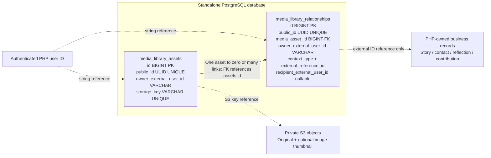

# YourStoriesLive — AWS media and hosting POC record

Recorded: **9 October 2026 · Asia/Singapore**  
Status: **POC infrastructure fully removed; implementation retained on feature branches.**  
Companion: [HTML briefing](yourstorieslive-aws-media-poc-record.html)

## 1. The question we explored

Could we own the media experience in YourStoriesLive without changing the PHP team's media APIs or connecting to their database?

The POC introduced a separate media API in the NestJS BFF, a standalone RDS PostgreSQL database, and private S3 storage. PHP continued authenticating users and providing the rest of the application's business operations. Its returned `logged_in_user_id` supplied the stable identity used by the new media service.

The second question was operational: could the BFF and the current Next.js application run in AWS, be deployed from GitHub, and be paused between tests?

This record covers that experiment. It does not claim a complete PHP backend replacement or production readiness.

## 2. Scope and boundaries

| Area | POC decision |
|---|---|
| Authentication | Preserve PHP authentication and the established BFF session flow; use the authenticated identity for media ownership. |
| Media API | New `/api/v1/media-library/**` routes owned by the BFF. |
| Existing media | Preserve `/api/v1/media-assets/**` PHP compatibility APIs for comparison. |
| Persistence | Independent PostgreSQL metadata and relationships; no connection or foreign key to the PHP database. |
| File storage | Private S3 objects; short-lived upload/download authorization supplied by the BFF. |
| Initial users | New authenticated test users. Existing-user import remained a separate pilot/migration activity. |
| Frontend | Local Next.js against AWS BFF initially; then Next.js standalone server on ECS. Static S3 frontend hosting was discussed but not implemented. |
| Source work | `codex/media-platform-aws` in both frontend and forked BFF repositories. |
| Region | Singapore, `ap-southeast-1`; CloudFront added a global browser entry point. |

## 3. What we tried, in sequence

1. Mapped the PHP contracts and media touchpoints: gallery, stories, timeline, contacts, profile, Your Life, Advice, Reflections, Moments, comments, and contributions.
2. Defined media ownership from the authenticated PHP user ID and designed independent asset/relationship records.
3. Created new BFF upload, retrieval, annotation, relationship, sharing, deletion, and social-import interfaces alongside the compatibility APIs.
4. Provisioned private RDS/S3 plus ECS/Fargate, an ALB, Secrets Manager, SQS, monitoring, and GitHub deployment identity.
5. Tested from a localhost frontend against the AWS BFF. Built Linux container images in GitHub Actions and pushed them to ECR.
6. Extended frontend media wiring across gallery and other feature flows. Recorded the absence of automatic transcription for new AWS recordings.
7. Hosted the current Next.js server on the same ECS cluster and ALB, retaining the Next.js image optimizer.
8. Added CloudFront, edge HTTPS, API routing, and immutable build-asset caching. Used pause/resume workflows to stop compute between test sessions.
9. Resumed the environment on 9 October. Verified one frontend task at 1 vCPU / 2 GiB, one BFF task, healthy ALB targets, available RDS, and HTTP 200 from sign-in and BFF health endpoints.
10. Reviewed database inspection through ECS Exec and CloudShell VPC. The latter was guided but no CloudShell VPC environment was observed in the teardown inventory.
11. Deleted the complete POC infrastructure, retained artifacts, and the separately authorized remaining SAM bootstrap setup.

## 4. Architecture that was deployed

```text
Hosted browser ── HTTPS ── CloudFront
                            ├─ pages + assets ── shared ALB :8080 ── Next.js ECS task :3000
                            └─ /api/* ────────── shared ALB :80 ──── NestJS BFF ECS task :3001

Local Next.js browser ── approved CORS origin ── AWS BFF endpoint

NestJS BFF
  ├─ PHP API ── authentication and established business operations
  ├─ private RDS PostgreSQL ── new media metadata and relationships
  ├─ private S3 ── originals and generated image thumbnails
  └─ SQS + DLQ ── processing jobs consumed inside the BFF process

Browser ── short-lived authorized PUT/GET URL ── S3
```

The hosted frontend and BFF shared one ALB and ECS cluster. CloudFront routed `/api/*` to the BFF listener and other paths to the frontend. Only `/_next/static/*` used the optimized edge caching policy; page/API behaviors disabled caching. CloudFront-to-ALB traffic was HTTP in the POC. Its generated hostname provided browser-facing HTTPS without a custom domain.

The VPC spanned two Availability Zones with public application subnets and isolated database subnets. Fargate tasks received public IPs for outbound connectivity because no NAT Gateway was deployed. The ALB reached the tasks over the VPC network; task public IPs were not stable app URLs. RDS was private and accepted connections from the BFF security group.

## 5. AWS services and configurations

| Service | POC usage |
|---|---|
| ECS / Fargate | Two services on `ysl-bff-dev-cluster`; BFF 0.25 vCPU / 512 MiB, frontend 1 vCPU / 2 GiB. Desired counts could be set to zero. |
| ECR | Separate application image repositories; GitHub built Linux AMD64 images and tagged deployments by commit. |
| ALB | Shared, internet-facing endpoint, two listener/target-group paths, and application health checks. |
| CloudFront | Global generated HTTPS hostname; Price Class 200; API forwarding and immutable Next.js asset caching. No private S3 video CDN distribution was implemented. |
| RDS PostgreSQL | PostgreSQL 16, `db.t4g.micro`, Single-AZ, 20 GiB gp3, autoscaling limit 100 GiB, encrypted storage, one-day automated backup retention. |
| S3 | Private media bucket, public access blocked, SSL enforced, S3-managed encryption, origin-specific CORS, cleanup of unfinished multipart uploads. The client upload path used one presigned PUT per file. |
| SQS | Processing queue with four-day retention, 15-minute visibility timeout, three receives before DLQ; DLQ retention 14 days. |
| Secrets Manager | Five secrets: JWT, legacy client ID, legacy client secret, social-import configuration, and generated database credentials. |
| CloudWatch | Application/database logs, ECS Container Insights, BFF CPU and unhealthy-target alarms. |
| VPC / security groups | Public app and isolated DB subnets; private DB access; no NAT Gateway or VPC endpoints. |
| IAM / STS / OIDC | Runtime permissions and temporary GitHub deployment credentials. OIDC is the identity protocol and IAM trust feature. |
| CloudFormation / CDK | Versioned infrastructure stacks; CDK authored the BFF definitions, and CloudFormation applied resource changes. |
| Systems Manager / ECS Exec | Enabled operational access to the BFF container; PostgreSQL client was included in its image. |

ACM/custom DNS, AWS Transcribe, MediaConvert, adaptive video streaming, and a separate processing-worker service were not implemented in this POC. Small Lambda helper functions existed for CDK custom resources such as bucket cleanup and log retention; Lambda did not host the BFF.

## 6. How data was stored

The implemented schema had **two main media tables**, not a replicated PHP user database.

```text
PHP authenticated user ID (string)
  └─ media_library_assets.owner_external_user_id
       ├─ public_id (UUID exposed by the API)
       ├─ storage_key ── private S3 original
       ├─ thumbnail_storage_key ── image derivative when generated
       └─ id (internal BIGINT)
            └─ media_library_relationships.media_asset_id
                 ├─ context_type
                 ├─ external_reference_id
                 └─ recipient_external_user_id (shares only)
```

| Table | Main contents |
|---|---|
| `media_library_assets` | Owner ID, UUID, media kind, filename/MIME/size, S3 keys, captions, taken date, upload timestamps, processing status/error, dimensions, deletion timestamp. |
| `media_library_relationships` | Internal asset foreign key, owner ID, context type, external record ID/label, share recipient, timestamps, and deletion state. |

Supported contexts were `story`, `timeline`, `contact`, `profile`, `advice`, `reflection`, `moment`, `comment`, `contribution`, and `share`. Your Life attachment wiring reused the user-liking media integration; there was no separately named `life` context in this schema.

An external story/contact ID was a reference, not a database foreign key to PHP. The records did not establish synchronization or ownership of the PHP business objects. Production work must verify target existence and access at the API boundary.

S3 object keys used this structure:

```text
users/<SHA-256-of-owner-ID>/original/<media-UUID>/<sanitized-filename>
users/<SHA-256-of-owner-ID>/thumbnail/<media-UUID>/<filename>.webp
```

Hashing the owner ID organizes storage; it is not the authorization mechanism. The private bucket, IAM permissions, BFF checks, and signed requests control access.

The gallery used `taken_on` when present, otherwise `created_at` for month grouping. Upload date and the date a photo was originally taken remain separate concepts.

### 6.1. A fictional example to follow

These are illustrative rows matching the implemented schema, **not recovered POC records or a new database deployment**. Alex's PHP user ID is the string `1001`; Jordan's is `1002`. Alex creates story `501` and has contact `701`, representing Jordan. Jordan later uploads a photo for reflection `901` and contribution `601`.

Registration/sign-in alone does not insert a media user record: the current media schema has no users table. The authenticated ID is carried by the BFF session. The first upload creates an asset with that ID in `owner_external_user_id`. Tokens and passwords are not stored in these media tables.

### 6.2. Schema diagram



Only `relationships.media_asset_id → assets.id` is an actual database foreign key. It has `ON DELETE CASCADE` for a physical asset-row deletion. User IDs, external record IDs, recipient IDs, and S3 keys are references; PostgreSQL does not join into the PHP database or store file bytes. Normal application deletion uses `deleted_at` and S3 object deletion; cascade should not be confused with soft deletion.

The HTML includes a self-contained schema graphic with solid lines for the internal foreign key and dashed lines for external references. It does not require loading a diagram library from the internet.

### 6.3. Sample `media_library_assets` rows

The tables below are column projections for readability. Every actual asset has the additional fields described in the schema. A1/A2/A3/B1 are explanatory labels, not stored columns.

| Example | `id` (internal PK) | `owner_external_user_id` | `public_id` (API UUID) | `original_filename` | `media_kind` | `status` | `processing_status` |
|---|---:|---|---|---|---|---|---|
| A1 | 101 | `1001` | `11111111-1111-4111-8111-111111111111` | `beach.jpg` | image | ready | ready |
| A2 | 102 | `1001` | `22222222-2222-4222-8222-222222222222` | `birthday.mp4` | video | ready | ready |
| A3 | 103 | `1001` | `33333333-3333-4333-8333-333333333333` | `advice.webm` | audio | ready | ready |
| B1 | 201 | `1002` | `44444444-4444-4444-8444-444444444444` | `school.jpg` | image | ready | ready |

| `id` | `content_type` | `byte_size` | `caption` | `taken_on` | `created_at` | `thumbnail_storage_key` |
|---:|---|---:|---|---|---|---|
| 101 | image/jpeg | 1500000 | Summer at the beach | 2026-07-04 | 2026-10-09T10:30:00Z | Generated WebP key |
| 102 | video/mp4 | 25000000 | Birthday recording | NULL | 2026-10-09T10:31:00Z | NULL |
| 103 | audio/webm | 1200000 | Advice for the future | NULL | 2026-10-09T10:32:00Z | NULL |
| 201 | image/jpeg | 900000 | Our school days | 2005-06-12 | 2026-10-09T10:40:00Z | Generated WebP key |

`deleted_at` and `processing_error` are NULL for these active successful examples. Video/audio `processing_status = ready` reflects completion of the current worker branch; it does **not** mean a transcode or transcript exists. A1 appears in July 2026 because its taken date is known; A2/A3 fall back to October's upload date.

For asset 101, the actual object keys would be:

```text
storage_key:
users/fe675fe7aaee830b6fed09b64e034f84dcbdaeb429d9cccd4ebb90e15af8dd71/original/11111111-1111-4111-8111-111111111111/beach.jpg

thumbnail_storage_key:
users/fe675fe7aaee830b6fed09b64e034f84dcbdaeb429d9cccd4ebb90e15af8dd71/thumbnail/11111111-1111-4111-8111-111111111111/beach.webp
```

The prefix is SHA-256 of the string `1001`. For Jordan's `1002`, it is `b281bc2c616cb3c3a097215fdc9397ae87e6e06b156cc34e656be7a1a9ce8839`. RDS stores these durable keys, not an expiring signed URL. The BFF generates the URL when an authorized read is requested.

### 6.4. Sample connections: stories, contacts, profile and sharing

Projection of `media_library_relationships`; each actual row also has its own UUID, optional label, creation timestamp and deletion timestamp. All rows shown below are active (`deleted_at = NULL`). IDs are fictional.

| `id` | `owner_external_user_id` | `media_asset_id` (FK) | `context_type` | `external_reference_id` | `recipient_external_user_id` | Meaning |
|---:|---|---:|---|---|---|---|
| 10001 | `1001` | 101 | story | `501` | NULL | Alex's beach photo in story 501. |
| 10002 | `1001` | 102 | story | `501` | NULL | Alex's video in the same story. |
| 10003 | `1001` | 102 | timeline | `501` | NULL | A separate timeline-context connection, if that flow needs it. |
| 10004 | `1001` | 101 | contact | `701` | NULL | The same photo assigned to contact 701. |
| 10005 | `1001` | 101 | profile | `avatar` | NULL | The same asset selected as the profile photo. |
| 10006 | `1001` | 103 | advice | `801` | NULL | Audio attached to advice record 801. |
| 10007 | `1001` | 101 | moment | `802` | NULL | Photo attached to moment record 802. |
| 10008 | `1001` | 101 | share | `701` | `1002` | Explicit permission for Jordan to access this photo. |

Notice the difference: **contact `701` identifies a contact record; recipient `1002` identifies a signed-in user.** A contact link does not grant access by itself. The `share` row does. One story can have many assets, and one asset can have many relationships without duplicating the S3 original. A story displayed on the timeline does not automatically require a second `timeline` row; this sample shows what a separate timeline connection looks like when used.

The database's active-relationship unique index prevents duplicate links with the same owner, asset, context, external ID and recipient. Sharing keeps the original owner as `1001`; it does not create a second asset owned by `1002`.

### 6.5. Sample connections: reflection, contribution and comment

Jordan uploaded asset 201, so its owner remains `1002` even when Alex can see it.

| `id` | `owner_external_user_id` | `media_asset_id` | `context_type` | `external_reference_id` | `recipient_external_user_id` | Meaning |
|---:|---|---:|---|---|---|---|
| 10009 | `1002` | 201 | reflection | `901` | NULL | Jordan's photo in their reflection about Alex. |
| 10010 | `1002` | 201 | share | `901` | `1001` | Allows Alex to read the reflection's media. |
| 10011 | `1002` | 201 | contribution | `601` | NULL | Photo attached to Jordan's contribution to a story. |
| 10012 | `1002` | 201 | share | `601` | `1001` | Allows the story owner Alex to read that contribution media. |
| 10013 | `1002` | 201 | comment | `602` | NULL | Illustrative attachment to a comment record. |
| 10014 | `1002` | 201 | share | `602` | `1001` | Explicit media access for Alex for that comment. |

These rows illustrate storage and access mapping, not a completed cross-user acceptance test. The contribution integration uses a contribution link plus a recipient share with the same external reference ID. Invitation delivery, comment moderation, story visibility and access by anonymous invitees are separate authorization/business concerns; a media relationship alone does not implement those workflows.

### 6.6. How the screens find the correct files

| Screen / caller | Lookup | Result in the fictional dataset |
|---|---|---|
| Alex's Photos | Active ready assets with owner `1001` | 101, 102, 103 |
| Alex opens story 501 | Alex's active `story` links with external ID `501`, joined to ready assets | 101 and 102 |
| Alex opens contact 701 | Alex's active `contact` links with external ID `701` | 101 |
| Alex's profile avatar | Alex's active `profile` links with external ID `avatar` | 101 |
| Jordan's shared-media list | Active `share` links whose recipient is `1002` | Alex's asset 101, with its owner unchanged |
| Alex reads reflection 901 | Relevant reflection/share lookup for recipient `1001` | Jordan's asset 201 |
| Alex reads contribution 601 | Relevant contribution/share lookup for recipient `1001` | Jordan's asset 201 |

Example SQL for the owner/story path (fictional values; no database was recreated or seeded):

```sql
SELECT a.public_id, a.original_filename, a.storage_key
FROM media_library_relationships AS r
JOIN media_library_assets AS a ON a.id = r.media_asset_id
WHERE r.owner_external_user_id = '1001'
  AND r.context_type = 'story'
  AND r.external_reference_id = '501'
  AND r.deleted_at IS NULL
  AND a.owner_external_user_id = '1001'
  AND a.status = 'ready'
  AND a.deleted_at IS NULL;
```

The BFF returns API UUIDs and authorized signed content URLs, not the internal BIGINTs used in joins. Removing a relationship marks that link deleted; it need not delete the shared original. Deleting the asset is a different operation with deletion-impact checks and object removal.

## 7. New API and upload lifecycle

| API under `/api/v1/media-library` | Purpose |
|---|---|
| `POST /uploads` | Create an owner-scoped pending asset and signed PUT URL. |
| `POST /uploads/:mediaAssetId/complete` | Check object presence/size, mark upload ready, and queue processing. |
| `GET /` and `GET /groups` | List owner-scoped media with grouping, search, sorting, and assignment filters. |
| `GET /:mediaAssetId` and `PATCH /:mediaAssetId` | Read details and edit metadata. |
| `GET /:mediaAssetId/content` | Authorize owner/shared access and return a short-lived read URL. |
| `PATCH /annotations` | Apply annotations to an owner-scoped selection. |
| `GET /relationships`, `POST /relationships`, `PUT /relationships/:kind/:targetId` | Read, add, or replace application connections. |
| `GET /shared` | List media explicitly shared with the authenticated recipient. |
| `POST /social-imports` | Import a provider-authorized image into private S3. |
| `GET /deletion-impact` and `DELETE /` | Preview connections and delete an owner-scoped selection. |

Upload sequence: authenticated request → pending RDS asset → signed S3 PUT → completion check → ready asset → SQS job → image thumbnail/metadata. Current completion checks object size; full byte-level MIME validation, malware inspection, quotas, and stronger integrity checks remain production hardening work.

Signed PUT/GET URLs were configured for 15 minutes. The frontend never received general AWS credentials.

## 8. Frontend integration and validation evidence

| Feature area | Evidence in the retained implementation |
|---|---|
| Photos | Library upload/list/detail, selection, annotations, deletion, story/contact assignment, sharing, and social-import integration. |
| Stories / live timeline recording | New uploads and recordings route through the media library; relationship records connect media to business records. |
| Contacts / profile photo | Upload and relationship replacement paths; reads resolve standalone profile/contact media. |
| Your Life / Moments | Shared user-liking attachment preparation and relationship retrieval coexist with the established business-record APIs. |
| Advice / Reflections | Composer uploads through the new API, with manual transcript handling. |
| Comments / Contributions | Attachment and relationship/share wiring exists; full permission and anonymous-invitation scenarios still need acceptance testing. |

**Implemented in code is not equivalent to accepted end to end.** The user reported successful sign-in, image uploads, and playable videos during manual testing. Errors found during that work included S3 image hostname restrictions, videos incorrectly routed to the image optimizer, missing date grouping, and recorder MIME parameters causing upload validation failure. Code changes addressed those paths.

Before teardown on 9 October, AWS showed RDS `available`, one running task per service, healthy ALB targets, and HTTP 200 for the hosted sign-in page and BFF health through both ALB and CloudFront. Those health checks confirm reachability/startup; they are not a comprehensive business-flow or performance test.

Earlier guides record CI builds and tests, but no new full test suite was run for this documentation/cleanup. No signed `206` video request, CloudShell VPC database session, complete social-provider handshake, or full cross-user permission matrix was captured in this final verification.

## 9. Performance and security findings

| Finding | POC result / limitation |
|---|---|
| Hosted images felt slow | User reported about 4–7 seconds versus faster localhost loading. No repeatable before/after benchmark established a final improvement. |
| Image derivatives | SQS consumer inside BFF generated WebP thumbnails with Sharp, bounded to 600 × 600 and no enlargement. It was not a separate worker service. |
| Next.js optimizer | Retained by request. Current source formats include AVIF and WebP; a WebP-only configuration was not retained. Changing S3 signatures can produce new optimizer cache entries. |
| Video processing | Original file playback only. No compression, codec normalization, fast-start conversion, video poster generation, or HLS/DASH pipeline. |
| Byte ranges | S3 supports range GETs; browser playback uses signed S3 URLs. Live `206 Partial Content` behavior was not separately captured in this run. |
| Signed URL lifetime | New requests/seek operations after expiry may fail. Automatic URL renewal is not implemented; the UI retry helper appends a query parameter, which can invalidate S3 signatures. |
| Share revocation | Active share checks gate issuance of fresh URLs. Previously issued URLs can remain usable until expiry; there is no immediate per-viewer revocation of those URLs. |
| Transcription | New AWS audio/video does not use PHP transcription. Manual editable text remains; no AWS transcription pipeline was deployed. |
| Global availability | CloudFront provides edge entry/caching; compute and RDS remained in one region. The database was Single-AZ. This was not a multi-region or highly available production system. |
| Data safety | Development removal policies deleted RDS/S3, and backups were short-lived. Production needs retention, deletion protection, restore testing, explicit migrations, and permissions review. |

## 10. Deployment and cost lessons

GitHub Actions built Linux images instead of building deployment images on the MacBook. ECR stored images; ECS/Fargate ran them. GitHub OIDC and STS supplied temporary role credentials. Routine code changes updated image/task definitions and services; registry identity setup had a separate workflow. Normal deployment was intended to preserve persistent resources.

The historical SIT estimate was approximately **US$112–114 per average month** with both services continuously running and low media usage. This was a planning estimate, not an invoice. The prior table counted four Secrets Manager secrets; the deployed architecture had five including RDS credentials, so future estimates should use the full inventory.

Pausing ECS/RDS reduced compute charges but left ALB/public-IP, storage, secret, and other usage charges. The previous paused estimate was around US$30/month. RDS stopping is temporary and automatically restarts after seven days. A 1-vCPU Fargate task requires at least 2 GiB; 1 vCPU / 1 GiB is not a supported task size.

These figures are historical reference only. Re-price any future design for its region, usage, service counts, backup policy, and current rates.

## 11. Complete teardown record

On **9 October 2026**, all of these stacks reached `DELETE_COMPLETE`:

- `YslFrontendDevStack`
- `YslFrontendRegistryStack`
- `YslBffDevStack`
- `YslBffRegistryStack`
- `CDKToolkit`
- `aws-sam-cli-managed-default` (separately requested cleanup)

Also removed: media bucket and files, database and automated backups, frontend/BFF image repositories, queues, ALB and public task networking, VPC, runtime secrets, logs, deployment roles/OIDC provider, and retained bootstrap storage. Deletion was requested for all 21 historical application task-definition revisions. The SAM bucket's 22 stored versions and 22 delete markers were permanently removed.

The final checked Singapore inventory returned no active CloudFormation stacks, S3 buckets in this account, RDS instances, ECR repositories, SQS queues, Lambda functions, CloudWatch log groups, POC IAM roles, or allocated Elastic IPs. The POC CloudFront distribution had already been removed. This is the checked environment's inventory, not an account closure or an exhaustive audit of every AWS service/region. Account users, AWS-managed service roles, service history, and delayed billing records can remain.

**The POC database and uploaded media are permanently deleted. No final backup was created. Old testing endpoints no longer work.** Past usage may still appear in AWS billing after resources are gone.

Source code, local analysis, and feature branches were preserved. No application code was changed or committed as part of this cleanup. Resume workflows cannot restore deleted stacks; a new run requires provisioning, credentials, configuration, and fresh test data.

## 12. What to carry into the next experiment

1. Retain the separate BFF media boundary and standalone metadata model; agree on cross-feature authorization and relationship consistency.
2. Fix signed-URL renewal/retry, then measure startup/seek behavior and verify byte-range responses against representative videos.
3. Decide between the current ECS/ALB design and a simpler POC host using a freshly priced comparison. Keep HTTPS and private data access in either design.
4. Add image/video processing isolation, validation, resource limits, and monitoring before higher upload volume; decide whether posters/fast-start suffice before choosing adaptive streaming.
5. Add an independent transcription pipeline and keep machine transcripts separate from user edits.
6. Replace startup DDL with versioned migrations, set production retention/deletion protection, and test recovery.
7. Test ownership, sharing, revocation, invitation/contribution access, save/link failures, and every feature with two controlled users.
8. Treat existing-user migration as a reviewed copy-and-reconciliation pipeline. No bulk legacy migration was proven by this POC.

## Source references

Code snapshots inspected for this record: frontend `a6e75eb`; BFF `a695a27`, both on `codex/media-platform-aws`. These are local source snapshots, not a claim that every commit was the last deployed image.

- [BFF media API](../../yourstories-live-api-fork/src/modules/media-library/media-library.controller.ts)
- [Database schema](../../yourstories-live-api-fork/src/modules/media-library/media-library.database.ts)
- [S3 signing and image thumbnails](../../yourstories-live-api-fork/src/modules/media-library/media-library.storage.ts)
- [SQS consumer](../../yourstories-live-api-fork/src/modules/media-library/media-library.processing.ts)
- [BFF infrastructure](../../yourstories-live-api-fork/infra/bff-dev-stack.ts)
- [Frontend infrastructure and CloudFront](../../yourstorieslive/infra/frontend-service.yaml)
- [Frontend media API client](../../yourstorieslive/src/lib/api/services/media-library/media-library.ts)
- [Player retry handling](../../yourstorieslive/src/components/ui/use-media-source.ts)
- [Transcription limitation](media-transcription-current-limitation.md)
- [Legacy inventory/import pilot guide](legacy-media-pilot-migration-guide.md)
- [Historical cost guide](SIT-cost.md) — its live-endpoint descriptions predate teardown.
- [AWS Fargate task sizes](https://docs.aws.amazon.com/AmazonECS/latest/developerguide/fargate-tasks-services.html)
- [S3 range GETs](https://docs.aws.amazon.com/AmazonS3/latest/API/API_GetObject.html)
- [S3 signed URL behavior](https://docs.aws.amazon.com/AmazonS3/latest/userguide/using-presigned-url.html)
- [RDS stop behavior](https://docs.aws.amazon.com/AmazonRDS/latest/APIReference/API_StopDBInstance.html)

